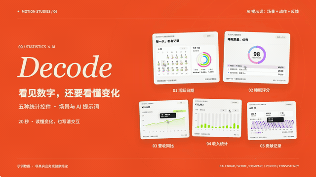

# Everyday Insights · 五种统计控件知识短片

20 秒，五种控件：**适用场景 + 可复用 AI 提示词 + 操作演示**。延续橙黑奶白的系列布局，控件保留 BoardUI 公开预览中的粉绿青、紫粉蓝、绿色和紫色阶。

[打开可交互演示 ↗](https://jdb156158.github.io/vibe-charts5/) · [观看完整 MP4](https://jdb156158.github.io/vibe-charts5/media/statistics-five-more-20s.mp4) · [下载视频源码 ZIP](https://jdb156158.github.io/vibe-charts5/media/statistics-five-more-source.zip)

## 视频效果

[](https://jdb156158.github.io/vibe-charts5/#film)

GIF 为静音预览。点击进入网页观看完整 1080p / 60fps MP4，含合成配乐与操作音效。

## 五种控件与可复用提示词

| 控件 | 使用场景 | 可复用 AI 提示词 | 操作演示 |
|---|---|---|---|
| 最活跃的日期 | 运动习惯回顾 | 做运动活跃日历，点选日期，联动当天详情。 | 滚动月份、点击日期，粉绿蓝三项数据联动 |
| 睡眠评分 | 睡眠记录与评分拆解 | 做睡眠评分环，悬停指标，高亮对应分段。 | 悬停指标行，聚焦紫、粉、蓝对应分段 |
| 营收图表 | 本年与去年同期比较 | 做营收同比图，悬停月份，同显两年与增幅。 | 实线与虚线同月聚焦，显示金额与增幅 |
| 收入图表 | 不同周期的收入汇总 | 做收入统计图，切换周月年，总额与柱形同步。 | 周切月，柱数、金额与标签同步；悬停单月 |
| 贡献记录 | 全年持续投入 | 做全年贡献图，按天着色，悬停显示日期与次数。 | 53 周紫色网格，读取单日日期与贡献次数 |

结尾：**场景 + 动作 + 反馈**。让数字，回应每一次投入。

## 整片制作提示词

> 做一期 20 秒、1920×1080、60fps 的五种统计控件知识视频。依次为 BoardUI 最活跃日期、睡眠评分、营收图表、收入图表、贡献记录。外层保留橙色首尾、纸白与炭黑正文、左侧英文衬线大标题和中文场景、右侧控件操作的系列排版。控件内部用原站颜色：活动日历粉绿蓝，睡眠评分紫粉蓝，财务图绿色，贡献记录紫色。每段都显示适用场景、两行可复用 AI 提示词以及一次明确操作反馈。2 秒开场、五段各 3 秒、3 秒收尾，首尾五个控件同时出现并编号。结尾总结“场景 + 动作 + 反馈”。所有自建数据标示为示例，日历、总计与同比口径一致。用 Canvas 的 window.draw(t) 确定性渲染，先检查九帧并修改两轮，Python 合成 120 BPM 配乐及操作音效，Playwright 逐帧导出，FFmpeg 编码 H.264 + AAC。


## 亲手体验

- 活跃日历：切换月份、滚动和点选日期，活动环与详情同步。
- 睡眠评分：悬停或点选指标，聚焦对应分段。
- 营收同比：悬停月份，同时读取本年、去年与同比增幅。
- 收入统计：切换周 / 月 / 年，更新柱数、总额与标签，悬停读取金额。
- 贡献记录：点击全年日期格，显示当日次数；支持日期选择器。

提供键盘选择、触屏替代操作与文字状态反馈。所有业务与健康数值均为演示示例。

## 制作步骤

1. 核实公开预览、配色和数据口径，写出带时间码的分镜。
2. Canvas 编写确定性 `window.draw(t)`，五段各讲清一条提示词。
3. Playwright 导出九帧自查，完成两轮修改后渲染 1,200 帧。
4. Python 合成 120 BPM 配乐和音效，混音控制峰值与结尾淡出。
5. FFmpeg 编码 H.264 + AAC MP4，检查播放与跳转。
6. 复用绘图代码制作交互网页，测试五种操作、手机布局与线上播放，部署 GitHub Pages。

[详细制作与复现步骤](docs/MAKING.md) · [完整提示词](docs/PROMPTS.md) · [分镜与来源](film/treatment.md) · [数据和许可](docs/CREDITS.md)

## 本地运行

```sh
python3 -m http.server 4853
```

打开 http://localhost:4853/ 。重新渲染影片的方法见制作说明。视频工程位于 `film/`，交互网站位于根目录与 `site/`。
