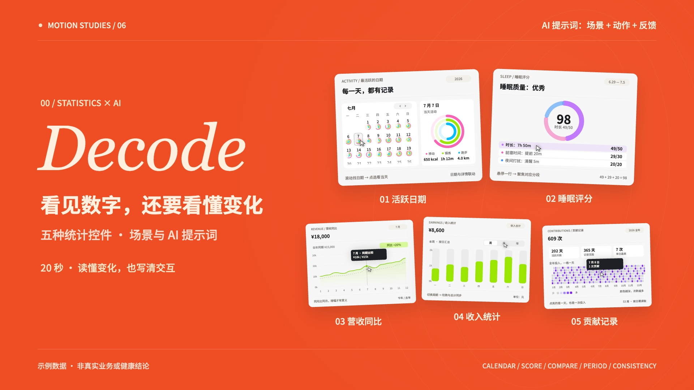

# 五种统计控件 · 场景、动作、反馈

20 秒 / 1920×1080 / 60fps。五个控件沿用 BoardUI 浅色预览中的内部配色，外层延续系列的橙黑奶白、英文衬线大标题与左文右图布局。



成片 `statistics-five-more-20s.mp4` 与源码 ZIP 分开交付。逐条来源和时间码见 [treatment.md](treatment.md)。

## 五种控件与可复用提示词

| 控件 | 使用场景 | 可复用 AI 提示词 | 操作演示 |
|---|---|---|---|
| 最活跃的日期 | 运动习惯回顾 | 做运动活跃日历，点选日期，联动当天详情。 | 滚动月份、点击日期，粉绿蓝三项数据联动 |
| 睡眠评分 | 睡眠记录与评分拆解 | 做睡眠评分环，悬停指标，高亮对应分段。 | 悬停指标行，聚焦紫、粉、蓝对应分段 |
| 营收图表 | 本年与去年同期比较 | 做营收同比图，悬停月份，同显两年与增幅。 | 实线与虚线同月聚焦，显示金额与增幅 |
| 收入图表 | 不同周期的收入汇总 | 做收入统计图，切换周月年，总额与柱形同步。 | 周切月，柱数、金额与标签同步；悬停单月 |
| 贡献记录 | 全年持续投入 | 做全年贡献图，按天着色，悬停显示日期与次数。 | 53 周紫色网格，读取单日日期与贡献次数 |

结尾：**场景 + 动作 + 反馈**。让数字，回应每一次投入。

## 整片制作提示词

> 做一期 20 秒、1920×1080、60fps 的五种统计控件知识视频。依次为 BoardUI 最活跃日期、睡眠评分、营收图表、收入图表、贡献记录。外层保留橙色首尾、纸白与炭黑正文、左侧英文衬线大标题和中文场景、右侧控件操作的系列排版。控件内部用原站颜色：活动日历粉绿蓝，睡眠评分紫粉蓝，财务图绿色，贡献记录紫色。每段都显示适用场景、两行可复用 AI 提示词以及一次明确操作反馈。2 秒开场、五段各 3 秒、3 秒收尾，首尾五个控件同时出现并编号。结尾总结“场景 + 动作 + 反馈”。所有自建数据标示为示例，日历、总计与同比口径一致。用 Canvas 的 window.draw(t) 确定性渲染，先检查九帧并修改两轮，Python 合成 120 BPM 配乐及操作音效，Playwright 逐帧导出，FFmpeg 编码 H.264 + AAC。

## 制作步骤

1. 核对五个公开组件页面，并从公开 CSS 变量与实际预览确认配色；不读取 Pro 源码。
2. 写分镜与数据口径。电影共 40 拍，切场在整数拍；指针动作与提示音对应。
3. 独立绘制日历、分段评分环、同比曲线、周期柱形和全年网格。所有状态只依赖时间 t；字体和脚本本地加载。
4. 导出九个关键帧。第一轮修正活动数值对齐、迷你环与详情的一致性、年度同比计算；第二轮增加日历底部遮罩、改进指针移动和非选中分段的可读性。
5. Python 合成配乐和提示音；18 秒结束新的鼓点，留出主和弦尾音，最后淡出。
6. Playwright 导出 1,200 帧 JPEG，再用 FFmpeg 合成 H.264 Main / yuv420p + AAC，启用 faststart。
7. 从最终 MP4 抽帧复核，并检查完整播放和跳转。

## 复现

需要 Node.js、Python 3、NumPy、FFmpeg 与 Chrome。

```sh
npm install
python3 -m pip install numpy
python3 make_audio.py
node render.mjs
node render.mjs full
sh encode.sh
```

默认使用 macOS Chrome；其他系统设置环境变量 `CHROME_PATH`。安装 huashu-motion 后可运行 `npx huashu-motion studio . --no-open`，拖动时间线检查。影片为模拟操作，本目录不是可直接点击图表的交互产品网页。

## 数据与许可

- 日历使用 2026 年实际星期位置；7 月 10 日的 816 kcal、1h 41m、5.2 km 来自原站公开示例。7 月 7 日等其他数据为自建演示。环形的演示目标分别为 1000 kcal、120 分钟和 8 km。
- 评分沿用公开示例：49 + 29 + 20 = 98，不代表医学评分标准。
- 营收：本年 193,000 元、去年 158,000 元，全年约 +22%；7 月 18,000 / 15,000，12 月 24,000 / 20,000，均 +20%。为自建示例。
- 收入：周合计 8,600 元，12 个月合计 73,500 元，11 月 11,800 元。为自建示例。
- 贡献：2026 年 365 日落在 53 周网格，609 次、202 个活跃日、单日最多 7 次，全部由固定公式产生；无不带种子的随机数。
- 字体 Noto Sans SC，OFL 文件位于 assets/fonts；英文 Georgia 为系统字体。GSAP 与 OM 的许可证在 vendor。音乐与音效由 Python 合成。
